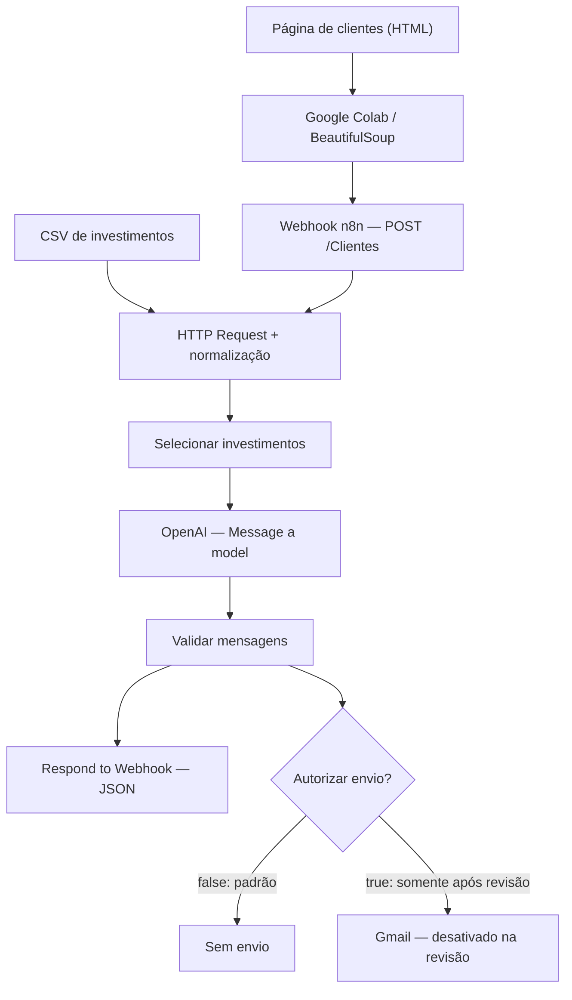

# Assistente de Investimentos com RPA, n8n e IA Generativa

> Laboratório educacional da DIO. **Não constitui recomendação de investimento.**

Projeto que combina extração de dados com Python/BeautifulSoup, automação no n8n Cloud, consulta a uma base CSV de produtos financeiros e geração de mensagens informativas com OpenAI. O envio de e-mails aos clientes permanece **bloqueado** até revisão e autorização.

## Arquitetura

## Resultados observados

| Etapa | Evidência |
| --- | --- |
| Extração no Colab | 10 clientes exibidos e POST com status HTTP 200 |
| Normalização no n8n | 9 investimentos |
| Seleção por perfil e saldo | 10 registros |
| OpenAI (Gateway credits) | 10 respostas geradas |
| Validação de mensagens | 10 registros |
| IF de autorização | 10 registros na saída FALSE; 0 na TRUE |
| Gmail | Workflow **separado** executou 1 operação de teste, sem confirmação de recebimento |
| Resposta HTTP ao Colab | Na versão original, status 200 com corpo vazio; **correção ainda não testada** |

## Estrutura do repositório

- [`rpa/extrair_clientes.ipynb`](rpa/extrair_clientes.ipynb): notebook presente no GitHub. **A versão atualmente publicada ainda contém o TODO de envio ao webhook e não corresponde ao Colab testado**.
- [`docs/index.html`](docs/index.html): página HTML de clientes do repositório.
- [`docs/data.csv`](docs/data.csv): base CSV do repositório.
- [`docs/IMPLEMENTACAO.md`](docs/IMPLEMENTACAO.md): documentação técnica, execução, segurança e pendências.
- `n8n/workflow.json`: **a publicar após importar e validar a revisão do workflow**.
- `evidencias/`: **a preencher com capturas de tela sanitizadas**.

## Como executar

1. Abra o notebook no [Google Colab](https://colab.research.google.com/github/Black2026/dio-lab-assistente-investimentos-rpa-n8n/blob/main/rpa/extrair_clientes.ipynb) e atualize-o para a versão efetivamente testada antes da entrega final.
2. Importe a revisão do workflow no n8n Cloud como **novo workflow** e configure a credencial OpenAI/Gateway, quando disponível.
3. No Webhook, use o método `POST`, caminho `Clientes` e resposta via nó `Respond to Webhook`.
4. Para testes, clique em **Listen for test event** e configure o Colab com a URL de teste exibida no nó, terminada em `/webhook-test/Clientes`.
5. Envie o payload `{"clientes":[{"nome":"...","email":"...","saldo":12500,"perfil":"Conservador"}]}` e confira os nós e a resposta JSON.
6. Mantenha o Gmail desativado e `aprovado_para_envio: false` até revisão humana e testes de correspondência.

## Situação da entrega

**Implementação demonstrada parcialmente; teste integrado final pendente.** Ainda é necessário publicar o notebook atualizado, importar e testar o JSON revisado, verificar a resposta HTTP e anexar evidências sem informações sensíveis. Não há afirmação de envio automatizado aos 10 clientes.

Veja os detalhes em [Documentação técnica](docs/IMPLEMENTACAO.md).

## Referências

- [Desafio DIO — fonte de clientes](https://digitalinnovationone.github.io/dio-lab-assistente-investimentos-rpa-n8n/)
- [n8n — Webhook](https://docs.n8n.io/integrations/builtin/core-nodes/n8n-nodes-base.webhook/)
- [Beautiful Soup](https://www.crummy.com/software/BeautifulSoup/bs4/doc/)
